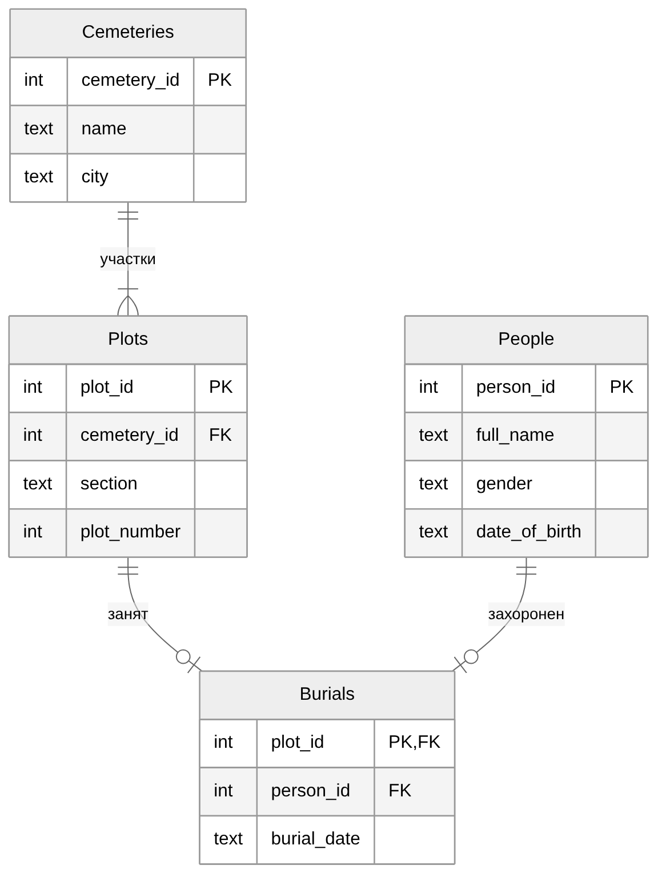
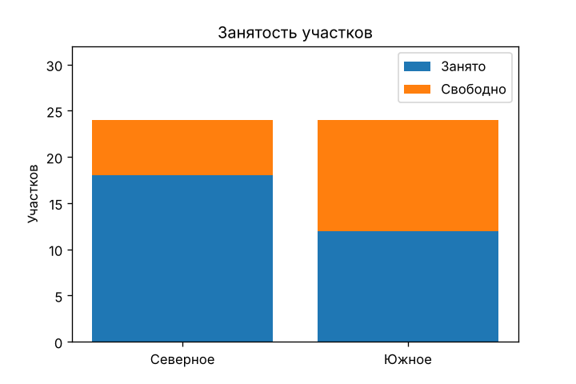
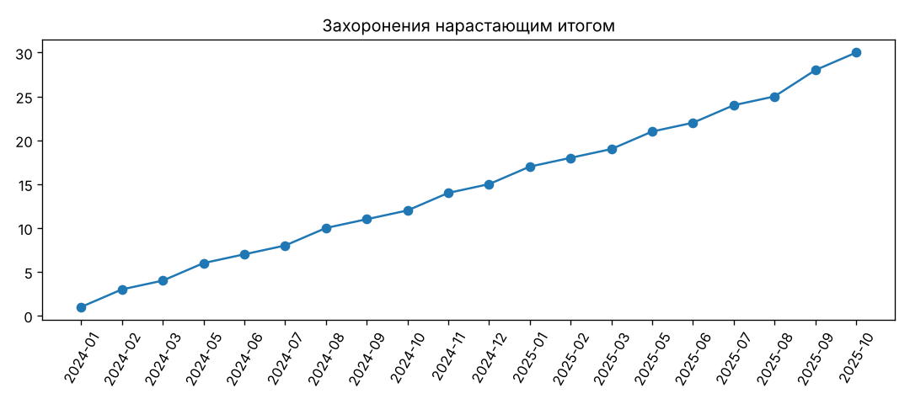
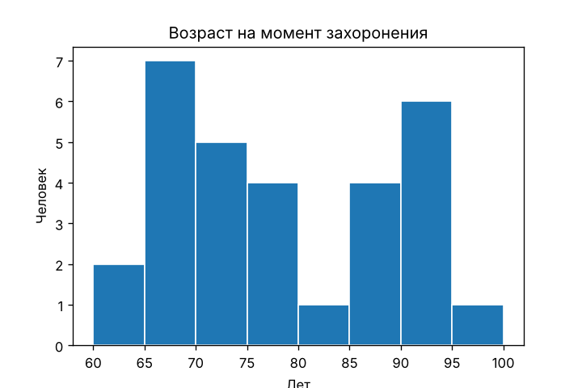

# NecroMap: учёт участков и захоронений

Учебный командный проект, экономический факультет МГУ, курс «Информационные технологии в менеджменте», 2025.

**Стек:** Python (pandas, matplotlib), SQLite, SQL, Excel.

## О проекте

Кладбища часто ведут учёт в бумажных книгах и разрозненных Excel-файлах. NecroMap переносит этот учёт в одну базу данных: можно найти человека по ФИО, посмотреть участок, увидеть свободные места и посчитать, на сколько их хватит.

## Как запустить

Нужен Python 3.10 или новее. Команды выполняются из папки проекта (на Mac — `python3` и `pip3`).

```bash
pip install -r requirements.txt

python app/create_db.py      # создать базу с демонстрационными данными
python app/cemetery.py       # программа учёта
python app/report.py         # отчёт в Excel и графики
```

`python app/clean_data.py` проверяет исходные Excel-файлы команды. Они содержат ФИО и ИНН, поэтому в репозиторий не выложены: чтобы запустить проверку, положите их в папку `source/`.

## Очистка данных

В исходных файлах 966 записей о людях и 1000 адресов. Найдено 389 проблем:

| Проблема | Строк |
|---|---|
| пустой ИНН | 137 |
| не указан пол | 137 |
| пол не совпадает с отчеством | 14 |
| вместо даты рождения текст | 2 |
| Excel превратил номер дома в дату | 69 |
| индекс пустой или не из 6 цифр | 11 |
| у одного события разные даты | 6 |
| человек участвует в событии после своего захоронения | 7 |
| захоронен, но нет события, где он умерший | 5 |
| умерший в событии, но нет участка | 1 |

ИНН и пол пропущены у одних и тех же 137 записей. Неверные значения очищены, все проблемы записаны в журнал `output/problems.csv`.

## База данных



## Программа

Меню в терминале, два режима: администратор добавляет и удаляет людей и регистрирует захоронения, архивариус только смотрит данные. Программа не даёт занять участок дважды, ввести несуществующую дату или дату захоронения раньше даты рождения.

## SQL-запросы

`sql/queries.sql`:

1. Кто похоронен на участке — JOIN
2. Занятость по кладбищам — LEFT JOIN, GROUP BY
3. Кладбища, где занято больше 15 участков — HAVING
4. Свободные участки — LEFT JOIN, IS NULL
5. Люди без захоронения — подзапрос, COALESCE
6. Мужчины и женщины — CASE
7. Захоронения по месяцам с нарастающим итогом — CTE, SUM() OVER
8. Порядковый номер захоронения на кладбище — ROW_NUMBER, PARTITION BY

## Отчёт

`reports/report.xlsx`: на листе «Анализ» показатели считаются формулами (СЧЁТ, СЧЁТЕСЛИ, СЧЁТЕСЛИМН, ЕСЛИ, СРЗНАЧ, МИН, МАКС, РАЗНДАТ), на листе «Захоронения» ФИО подтягивается через ВПР.

На демонстрационных данных (2 кладбища, 48 участков, 30 захоронений с января 2024 по октябрь 2025):
- занято 62,5% участков: «Северное» — 75%, «Южное» — 50%
- в среднем 1,36 захоронения в месяц, свободных мест хватит примерно на 13 месяцев
- средний возраст на момент захоронения — 78 лет




